# UX pass (KAO-34)

Goal: the main flow works with zero docs. Open the app, start an agent, start a second, link them, send a handoff.

I walked the app with Playwright's Electron driver (screenshots in `docs/ux-pass/`), wrote down everything confusing or glitchy, then fixed it. The `before-*` shots are from main at `2ff37f2`, the `after-*` shots from this branch.

## What was confusing or broken

| # | Finding | Root cause | Fix |
| -- | -- | -- | -- |
| 1 | First launch drops you into a raw shell tile. Nothing says "agents", nothing says what to do next. | `startWorkspace` added a shell tile when nothing was saved. | The canvas starts empty, with one centered **Start an agent** and two big buttons: Claude Code and Shell. |
| 2 | Starting a tile takes two clicks and a form: five presets, folder, recents, title, Cancel, Open tile. | One flat launcher for every option. | **New tile** shows the same two big buttons (one click starts) plus the folder. Codex, Gemini, custom command and tile name sit under **More options**. |
| 3 | A new tile lands on top of the last one and covers its link port, so you can't link until you drag tiles apart. | `placeNewTile` centered every tile in the view and only dodged a tile at the exact same spot. | New tiles go right of the focused tile (else below, else further right), 96 px apart and never overlapping. The view pans just enough to show them. |
| 4 | Two tiles both called "Shell", so the handoff says "Handoff from Shell" with no way to tell which. | Titles were the preset name. | Repeated names are numbered: Shell, Shell 2. A tile started in a folder is called e.g. "Claude Code · my-repo". |
| 5 | Title bar says "shell" twice: the name, then a "shell" status label. | Status was a dot plus a word. | One status dot before the name (hover for Working, Ready, Needs you, Exited or Shell). The × only shows on hover. |
| 6 | Linking means finding a 14 px dot that only shows on hover or focus, and nothing says linking exists. | Small target, no hint. | The whole right edge of a tile is the handle (crosshair cursor, the dot lights up). The first time there are two tiles and no link, a hint above the toolbar says how. It goes away for good after the first link. |
| 7 | Every link wears a "manual" chip, which is noise. The **Send →** chip sits under the tiles and is drawn in canvas space, so tiles cover it and it shrinks to unreadable when zoomed out. | Chips were part of the line, in the layer below the tiles, scaled with the world. | A manual link has no chip until there is something to send. Then one accent **Send →** button appears, in a layer above the tiles, always at screen size. Auto links show a small "Auto-send" chip; turning it on stays in the right-click menu. Lines keep a 2 px screen width at any zoom. |
| 8 | Once zoomed out there's no easy way back, and the only control is "+ New tile" in a corner. Shortcuts are undiscoverable. | No toolbar or help. | One small toolbar at the bottom: **+ New tile**, **Zoom to fit**, **?**. Zoom to fit stays at exactly 100% when everything fits, so terminals stay live. **?** lists every gesture in seven lines. |
| 9 | Zooming out flashes the tile empty for a frame, then the text jumps. | The snapshot was set in `useEffect`, after the browser had already painted the hidden terminal. Snapshot line height 1.2 vs xterm's 1.0. | The snapshot is taken in `useLayoutEffect`, before paint, and xterm and the snapshot share one font and line height. |
| 10 | Panning, dragging and wheel zoom push a store update for every pointer event, often several a frame on high-rate mice and trackpads, re-rendering the link layer each time. | Direct `panBy` / `moveTile` per event. | Pointer moves and wheel ticks are coalesced to one store update per animation frame (`perFrame.ts`), flushed on release. Pointer capture as before. Terminals still never re-render on pan; e2e checks the xterm element survives a drag. |
| 11 | A resize drag reflows the terminal every 50 ms. | Short fit debounce. | Refit once the size has been still for 120 ms, and once more when zoom returns to 100% (in case the tile was resized while zoomed out). |
| 12 | Started from inside Claude Code, tiles inherit `CLAUDECODE` / `CLAUDE_CODE_*`, so a nested claude skips its transcript and handoffs never get a result. | PTY env was a copy of `process.env`. | `tileEnv()` drops those variables (user config like `CLAUDE_CONFIG_DIR` is kept). |
| 13 | Green focus border, green/blue/orange states, a separate terminal palette, gradients on the resize grip. | Colours picked per feature. | One accent (soft blue) for focus, buttons, ports and Send. State colours are tuned to sit beside it, and the terminal theme uses the same background, text and accent. Flat surfaces with consistent 4/8/12/16/24 px spacing; no gradients or glass. |

| 14 | Real test: two real Claude Code tiles, linked. A finished, but the dots never changed and nothing was sent. | The hook wasn't in `~/.claude/settings.json`, so Claude Code never reported anything (the status file stayed empty), and nothing in the app said so. The e2e only faked Stop events, so it never noticed. | On launch the app checks settings.json. If the hook is missing, a banner says "Status and handoffs need a Claude Code hook. [Install] [Not now]". Install copies the script to `~/.config/agent-canvas/hooks/` (so the path survives moving or packaging the app; it is refreshed on every launch), backs up `settings.json.bak`, and appends one entry per event without touching other keys or hooks. |
| 15 | The empty canvas didn't say where an agent would start. | — | "in <folder> · change" under the big buttons. |
| 16 | "auto" on a line didn't say what it does. | — | Renamed "Auto-send", on the chip and in the menu. |

## Before and after

| | Before | After |
| -- | -- | -- |
| First launch | 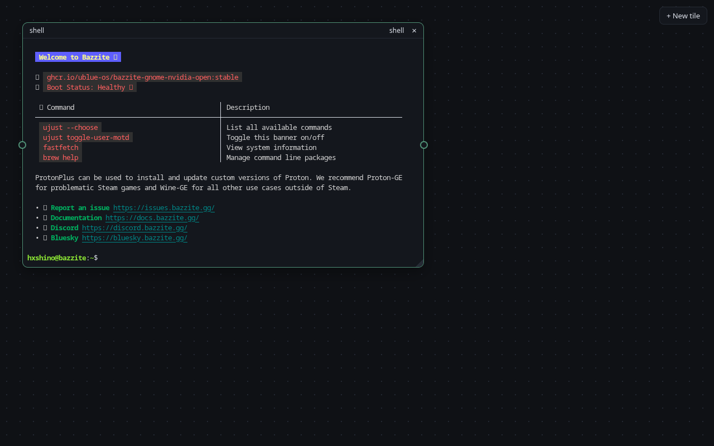 | 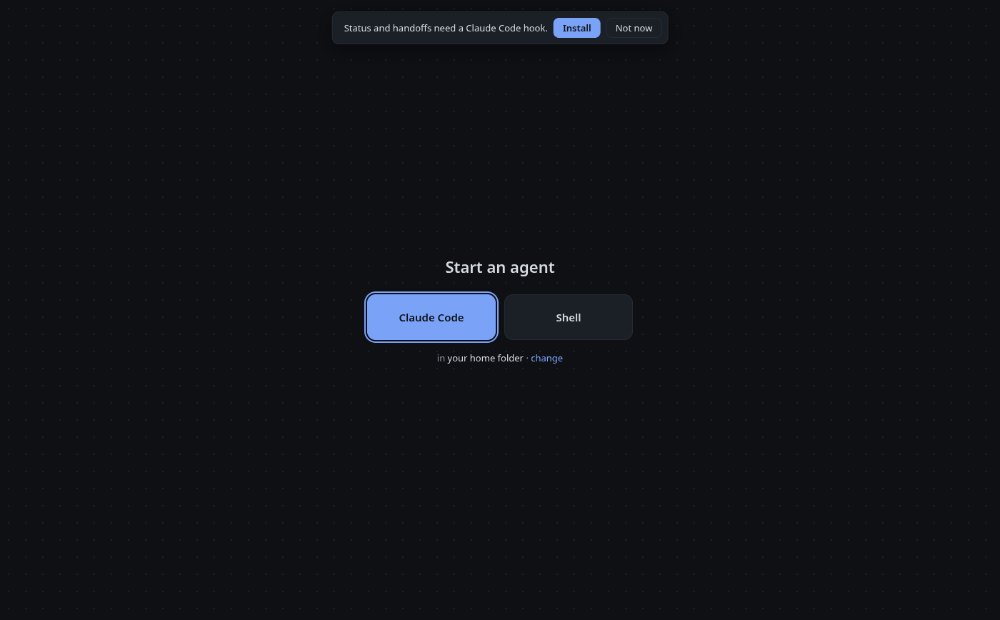 |
| New tile | 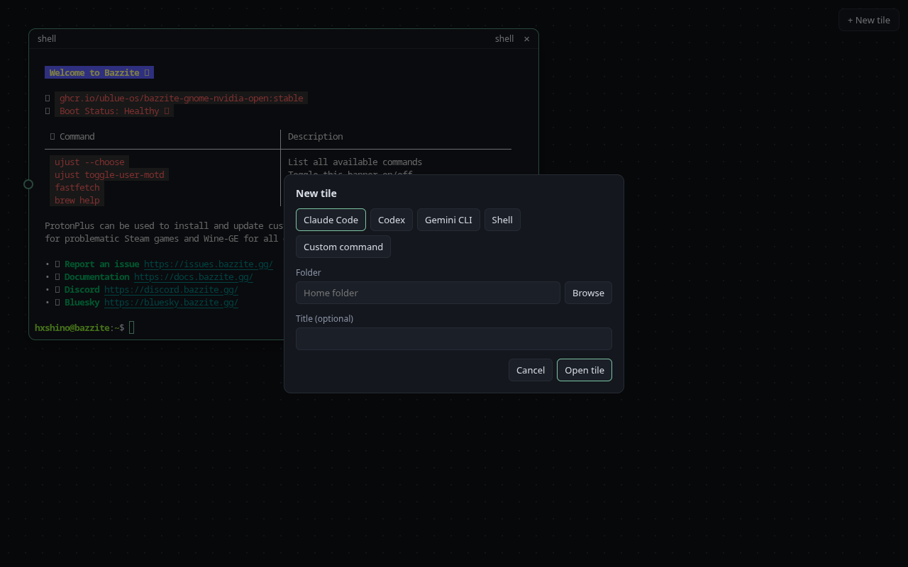 | 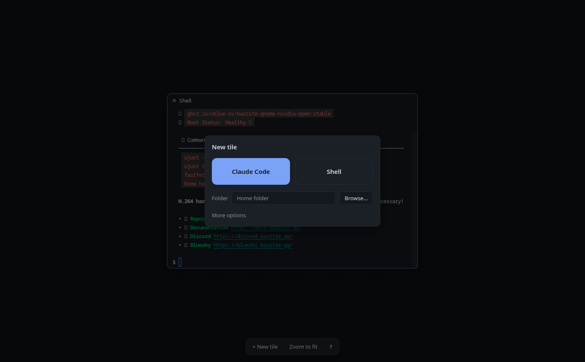 |
| Second tile | 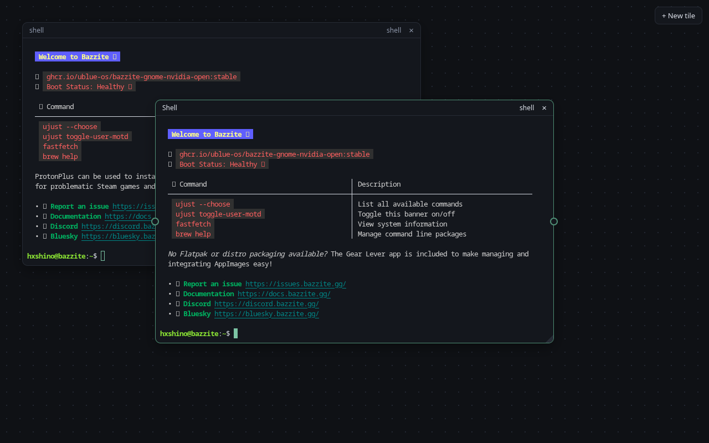 | 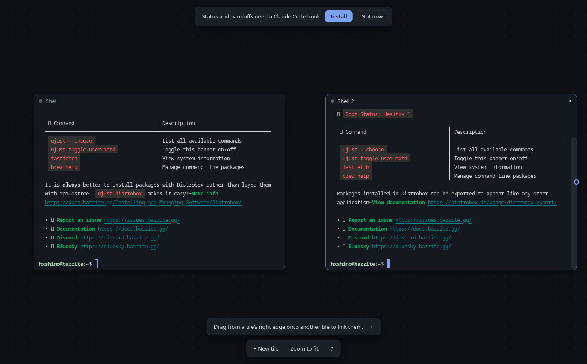 |
| Linking | 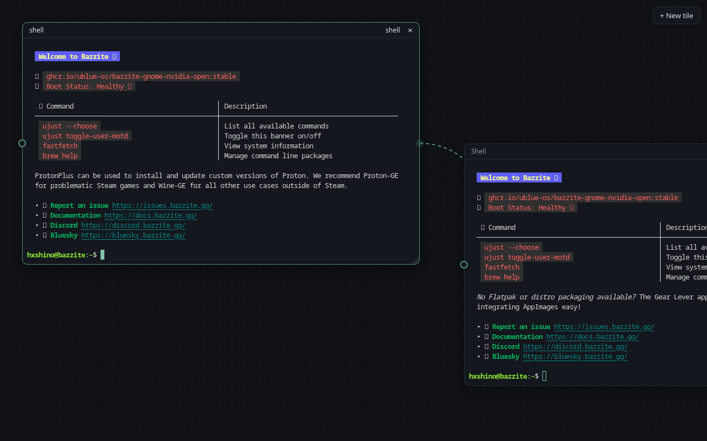 | 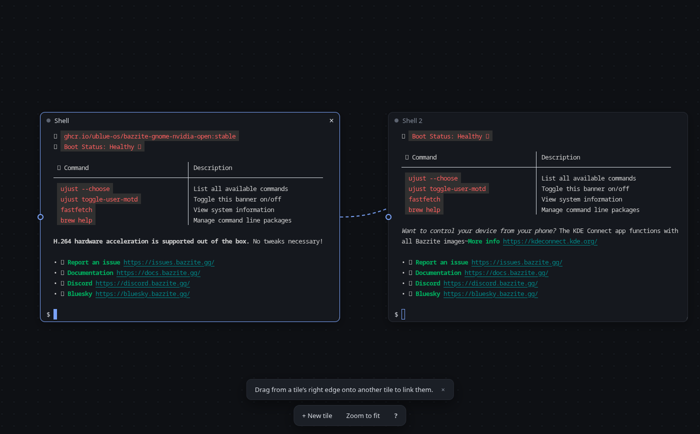 |
| Result ready | 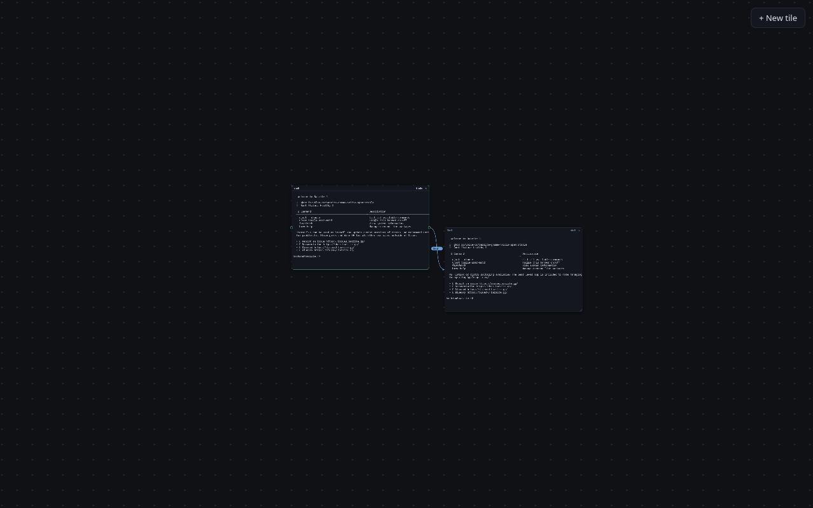 | 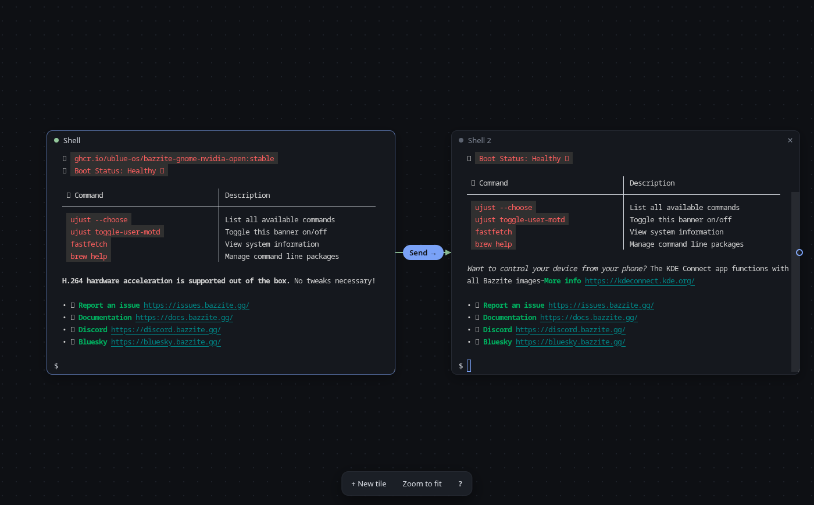 |
| Zoomed out | 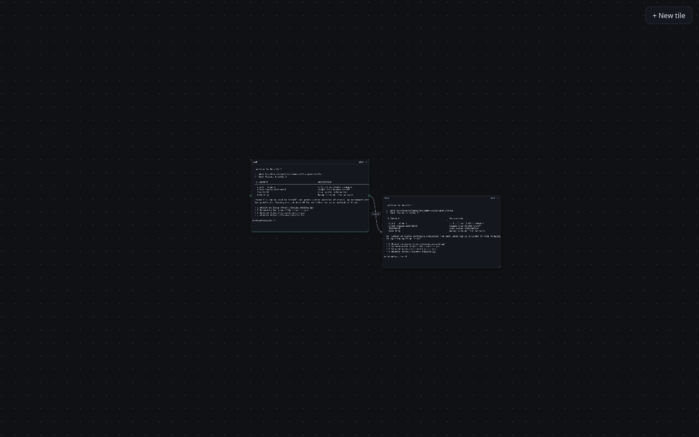 | 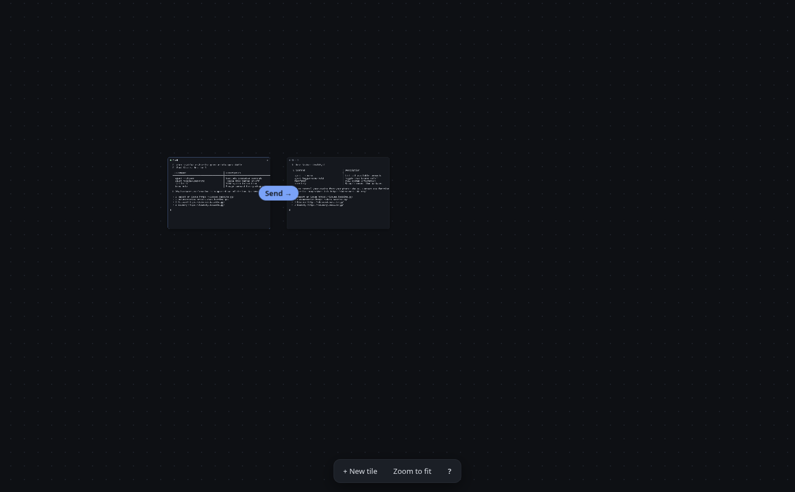 |

Also: `after-02-first-tile.png`, `after-03b-launcher-more.png` (More options open), `after-11-help.png`, `before-09-link-menu.png`.

## Real Claude Code run

`REAL_CLAUDE=1 npm run e2e -- real-claude` runs two real Claude Code tiles (haiku) linked A→B, using the installed hook. It checks four things:

- A's dot goes working, then Ready.
- **Send →** appears and pastes A's answer into B without pressing Enter.
- After switching to Auto-send, B starts on A's next answer by itself.
- B's screen then shows the result.

It passed. It keeps the inherited Claude Code variables, to show the app strips them.

| Send ready | Pasted into B | Auto-sent, B answered |
| -- | -- | -- |
| 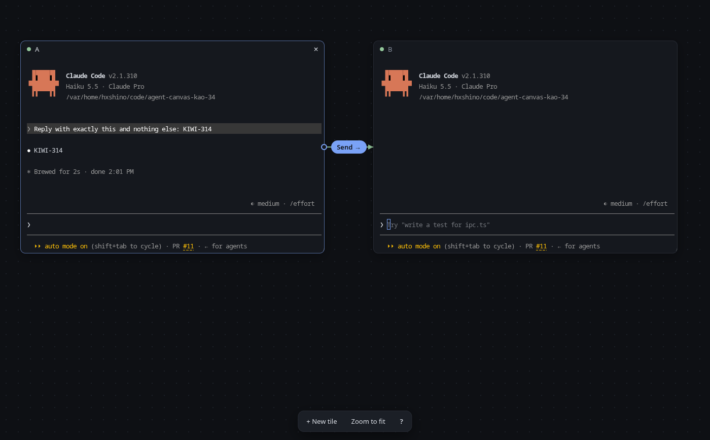 | 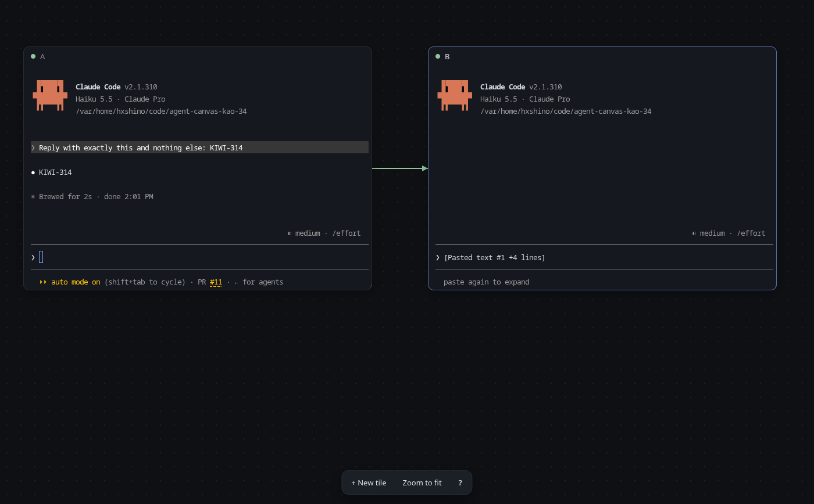 | 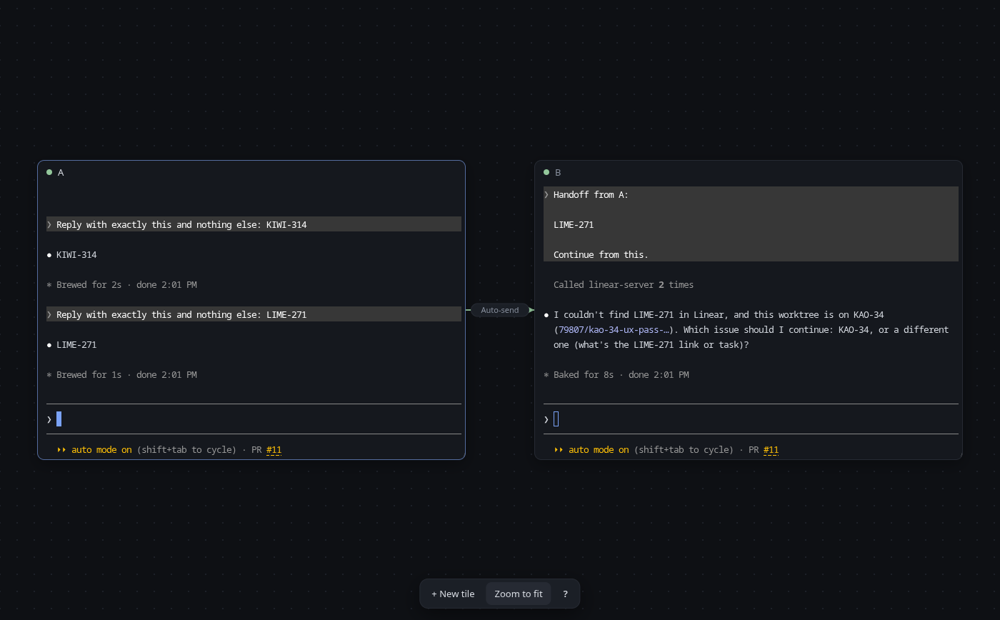 |

## Checks

`npm run e2e` drives the built app in a temporary home: start a tile from the empty canvas, drag it (terminal not rebuilt), zoom out and back with Zoom to fit, link two tiles by dragging the edge (line ends stay on the ports after a move), send a handoff from a faked Stop event into a `cat` tile, restore tiles and links after a restart, and press Install in the banner, after which a stand-in agent fires the hook command it reads from settings.json, its dot changes, and Auto-send delivers. Test windows open hidden and are shown on workspace 2 (`E2E_WORKSPACE`, 0-based) so a run doesn't cover your work.

## Left open

- Zoomed-out snapshots are still plain text (colours are KAO-30).
- The e2e run needs a desktop session (it runs under X11/XWayland).
